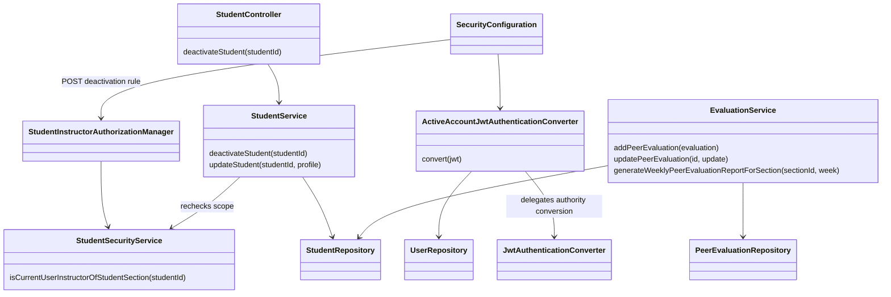
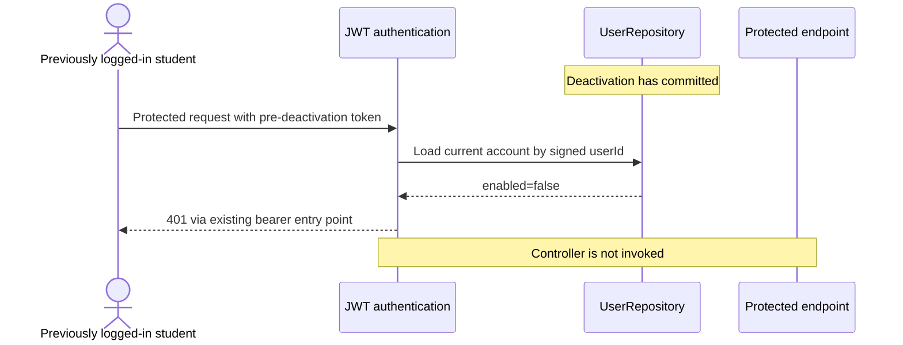

# **Student Design**

> Realizes: UC-STU-deactivate-student. Depends on: FR-SEC-active-account; BR-student-lifecycle, BR-section-scoped-access, BR-role-based-access, BR-deactivation-team-retention, BR-submission-owed, BR-evaluation-active-evaluatee, BR-evaluation-report-retention.
> Acceptance criteria: [use cases](../requirements/use-cases.md#uc-stu-deactivate-student-the-course-admininstructor-deactivates-a-student), [business rules](../requirements/business-rules.md), and [FR-SEC-active-account](../requirements/software-requirements-specification.md#non-use-case-functional-requirements).
> Architecture: [Container and Component views](architectural-design.md), [Crosscutting Concepts](architectural-design.md#crosscutting-concepts). Shared model: [SRS Business Domain Model](../requirements/software-requirements-specification.md#business-domain-model).

## **Overview**

Extend the existing student slice, shared JWT authentication, and evaluation slice. Keep the existing student row, course section, team, weekly activity reports, evaluations, and ratings. No schema change or deactivation-date migration is needed: inactive report inclusion depends on stored records for the requested week, not an inferred withdrawal date.

The dedicated deactivation request changes only `enabled`. Profile editing preserves the stored status. The shared reminders service already implements BR-submission-owed; reuse it and prove the consequences with tests.

## **Components and classes**

Paths below are relative to the repository root. Existing components are revised in place.

| Component | Reused or new | Change |
|---|---|---|
| `backend/src/main/java/team/projectpulse/security/ActiveAccountJwtAuthenticationConverter.java` | New | Wrap existing authority conversion; load current user by the signed JWT's `userId`, reject missing/malformed identity or a missing/inactive user with the existing bearer-authentication error path. |
| `security/SecurityConfiguration.java` under the same backend package root | Reused | Wire the converter and the explicit deactivation route before the API `denyAll()` rule. Preserve signature, expiry, and authority conversion. |
| `user/UserRepository.java` | Reused | Read current account by id; no enabled-state cache. Both student and instructor accounts use the shared identity model. |
| `student/StudentSecurityService.java` | Reused | Extend the existing section-instructor predicate to admit the owning course admin as required by the rules; reject missing links and non-instructor/admin callers. Reuse it for student detail access and the action. |
| `security/authorizationmanagers/StudentInstructorAuthorizationManager.java` | Reused | Existing student-id guard delegates to the corrected student-scope predicate; no second parallel ownership framework. |
| `student/StudentService.java`, `StudentController.java`, `StudentRepository.java`, `Student.java` | Reused | Transactional `deactivateStudent` action; recheck caller scope and target status in the service; set false only. General profile saves preserve persisted account status. |
| `evaluation/EvaluationService.java`, `PeerEvaluationRepository.java` | Reused | Guard both create and edit using current evaluatee status before mutating scores/comments. Load received section evaluations for the requested week, group by evaluatee, and apply report-row policy before computing averages. |
| `evaluation/PeerEvaluationAverage.java` | Reused | Keep the response shape and averaging formula. Refactor the existing helper to accept an already loaded evaluation list so report inclusion need not be guessed from an average of zero. |
| `notification/SubmissionStatusService.java` | Reused | No policy rewrite; integration tests demonstrate the existing shared calculation responds to deactivation. |
| `frontend/src/pages/students/EditStudentForm.vue` | Reused | Read-only persisted status and a distinct Deactivate student action with a warning; profile Confirm remains separate. |
| `frontend/src/apis/student/index.ts`, `types.ts` | Reused | Add `deactivateStudent(id)` through the shared Axios instance; reuse the standard Result and Student response types. |
| `frontend/src/pages/students/Students.vue` | Reused | Refresh the student list after an acknowledged result. |
| `frontend/src/pages/evaluations/SubmitTeamsEvaluations.vue` | Reused | Filter the entry roster by active status, and intersect already stored entries with that eligible roster. Keep historical rows on the server. Refresh eligibility if saving is refused because the evaluatee became inactive. |
| `frontend/src/utils/request.ts` | Reused | Existing 401 handling clears local credentials and redirects to login; do not add a second logout path. |



## **Sequence**

```mermaid
sequenceDiagram
    actor I as Course admin or assigned instructor
    participant UI as EditStudentForm
    participant Auth as JWT converter and route guard
    participant C as StudentController
    participant S as StudentService
    participant DB as Database
    I->>UI: View selected student (steps 1-2)
    I->>UI: Choose Deactivate student (step 3)
    UI-->>I: Named warning with Confirm and Cancel (step 4)
    I->>UI: Confirm (step 5)
    UI->>Auth: POST /students/{studentId}/deactivation
    Auth->>DB: Read caller account and current target scope
    Auth->>C: Authenticated and authorized request
    C->>S: deactivateStudent(studentId) (step 6)
    S->>DB: Reload target and recheck caller scope
    S->>DB: Set enabled=false; preserve other data
    DB-->>S: Transaction commits
    S-->>C: Current student
    C-->>UI: 200 Result with persisted student
    UI-->>I: Deactivated; refresh status/list (steps 6-7)
```

```mermaid
stateDiagram-v2
    [*] --> Active
    Active --> Warning : dedicated action
    Warning --> Active : Cancel or dismiss; no request
    Warning --> Pending : Confirm once
    Pending --> Inactive : acknowledged commit
    Pending --> Active : confirmed failed transaction
    Pending --> Unknown : response lost
    Unknown --> Active : fresh status read says active
    Unknown --> Inactive : fresh status read says inactive
    Inactive --> Inactive : repeated authorized request; already deactivated
```





A refresh failure leaves the action disabled with an unknown-outcome message. The UI state diagram describes the client operation, not a new database account-status enum. Reactivation is a separate use case.

## **API contract**

All paths below use the existing `/api/v1` base and Result/error conventions.

| Endpoint or existing path | Who may call it | Request | Success | Errors and extensions |
|---|---|---|---|---|
| **New** `POST /students/{studentId}/deactivation` | Owning course admin or instructor assigned to target course section; both must have an active account | Student id in path; no profile body | `200`, existing StudentDto with `enabled=false`; message distinguishes changed from already deactivated | `401` no valid active caller; `403` extension 1a; nonexistent/unscoped target at route guard also `403` without existence disclosure (2a); target disappearing after successful authorization yields `404` (2a); failed transaction yields existing `5xx` Result error (6b). Repeated authorized call is `200`, already deactivated (6a). |
| Existing `GET /students/{studentId}` | Existing self access while active; owning admin or assigned instructor | Student id | Current StudentDto, also used to resolve an unknown outcome | Existing `401/403/404`; owning admin works even when not assigned to the course section. |
| Existing `PUT /students/{studentId}` | Existing profile-edit permissions | Existing profile payload | Updated profile; stored `enabled` is preserved regardless of payload status | Existing validation/authorization errors; sending `enabled=false` or a stale `enabled=true` cannot deactivate/reactivate. |
| Existing `POST /evaluations` and `PUT /evaluations/{evaluationId}` | Active evaluator, with existing team/ownership/window rules | Existing evaluation payload | Existing response for eligible evaluatee | `400 INVALID_ARGUMENT` naming inactive evaluatee under BR-evaluation-active-evaluatee and UC-EVA-submit-evaluation 9a; existing stored scores/comments unchanged on refusal. |
| Existing `GET /evaluations/sections/{sectionId}/week/{week}` | Existing report permission | Course section and week | Existing report shape, applying BR-evaluation-report-retention | Existing permission and validation errors. Retain received evaluations authored by inactive accounts. |
| Existing reminder/status endpoints and scheduled job | Existing permission/configuration | Existing item/week inputs | Existing BR-submission-owed computation | No new route, request, or policy. |

The new rule is the exact POST matcher for `/students/{studentId}/deactivation`, using `studentInstructorAuthorizationManager` after correcting its delegated scope predicate. It is inserted before the API catch-all. The general student self-access manager does not guard this action.

## **Key decisions and rejected alternatives**

- **Live account check in JWT authentication.** Read current identity status on every bearer-authenticated request through the converter. Rejected waiting for token expiry because FR-SEC-active-account includes otherwise-valid credentials; rejected introducing a token blocklist because account status already represents this policy. No cache may defer an enabled-state change. Basic authentication retains its existing live UserDetails check.
- **Reuse one student-scope predicate.** Correct the existing predicate to support the owning course admin and reuse it for details and deactivation, then recheck in the transactional service. Rejected merely allowing `ROLE_instructor`, which grants no course section ownership, and a second manager duplicating section/course traversal. Regression tests cover the existing detailed evaluation route that uses the same manager.
- **Dedicated mutation, preserved profile status.** Profile editing cannot change `enabled`, including a stale profile saved after deactivation. Rejected keeping the switch as a second mutation path because it bypasses the warning. This removes the existing accidental generic reactivation switch; no replacement reactivation feature is implemented. This consequence was accepted with the design.
- **Retain links; evaluate only active members.** Keep generic team roster APIs complete so team/history views retain membership. Filter only the peer evaluation entry view, including its already-saved entries. Rejected globally filtering the team roster, which would make membership/history disappear from unrelated views.
- **Retain report data by requested week.** Batch-load received evaluations for that course section/week, include inactive evaluatees with records, and keep all their received evaluations regardless of evaluator status. Rejected excluding all inactive students, which erases history from reports; rejected empty rows for all future weeks, which fabricates apparent missing grades; rejected using average score zero to identify an empty report, since zero can be a real score.
- **Repeat as success with an explanatory message.** Re-read and set false without changing other fields. Rejected toggling and a retry error because an earlier confirmation or a second instructor may already have completed the action. A lost response still requires a fresh status read, not an automatic retry.
- **No historical date inference.** No new deactivation timestamp or roster snapshots; an inactive student appears whenever the requested week has stored received evaluations. This also covers data retained after a later team removal. Closed submission windows and existing access rules still apply.

## **Data model and reuse**

No tables, columns, migrations, membership deletion, evaluation deletion, or rating deletion. Reuse `Student.enabled`, `UserRepository`, standard DTO conversion/Result, the existing JWT authority converter, the shared Axios client, and the notification slice's definition of owed work. Reports add a repository read for received evaluations in a course section/week, scoped by the evaluatee's course section.

## **Tests**

These are **planned**, not implemented or passing. Each row names a specification oracle. Backend integration tests use the actual security filter chain and a genuinely signed token obtained before deactivation; Spring's mock JWT postprocessor would bypass the new authentication converter and is insufficient evidence for these rows. UI integration rows may stub APIs and must be described as such.

| Row / flow | Level | Assertion and oracle |
|---|---|---|
| T01 — main steps 3-6, warning | UI integration | Dedicated action opens a warning naming the persisted target and all consequences cited in step 4; no deactivation request before Confirm. |
| T02 — main steps 5-7, save | Backend integration | Assigned instructor gets success; persisted enabled is false; profile, course section, team, activities, authored/received evaluations, ratings and comments are unchanged. Oracle: POST-1/2 and BR-student-lifecycle. |
| T03 — admin ownership | Backend integration | Owning course admin who is not assigned to the course section can read student details and deactivate. Oracle: BR-student-lifecycle and BR-section-scoped-access. |
| T04 — 1a, other instructor | Backend integration | Unassigned instructor in the same course receives 403; all target data unchanged. |
| T05 — 1a, other course admin | Backend integration | Unassigned admin owning a different course receives 403; all target data unchanged. |
| T06 — 1a, student/anonymous | Backend integration | Student self and another student receive 403; unauthenticated request receives 401. No mutation. Oracle: 1a, BR-role-based-access. |
| T07 — 1a, changed authority | Backend integration | Remove the instructor's course section assignment after details/warning are loaded; confirmation is refused. Oracle: 1a at step 6. |
| T08 — 1a, service boundary | Unit | Direct service call with unauthorized scope is refused before setting enabled or saving. Oracle: 1a and BR-student-lifecycle. |
| T09 — 2a, missing target | Backend integration | Nonexistent target at route guard returns non-disclosing 403, not 500; no data is returned. Oracle: 2a2. |
| T10 — 2a, disappeared target | Unit | Target missing at service load produces not-found behavior, no save. Oracle: 2a1; route/service race maps to existing 404 handling. |
| T11 — 5a, Cancel/dismiss | UI integration | Cancel, Escape, and close/dismiss produce zero deactivation calls and preserve displayed status. |
| T12 — 6a, repeat | Backend integration | First and repeated authorized calls both return false status; repeat says already deactivated; no team/work changes. No unrelated active student is required. |
| T13 — 6b, failed persistence | Backend integration | Force persistence failure in the real transactional service path; after rollback a fresh database read finds enabled unchanged and history intact; HTTP result is an error, not success. |
| T14 — 6b, error display | UI integration | A definite server failure never displays success or flips local status. |
| T15 — 6b, lost response | UI integration | Simulate a lost POST response with both possible server outcomes; require a successful GET before another attempt, reflect its status, and keep action disabled if GET also fails. No automatic POST retry. |
| T16 — duplicate Confirm | UI integration | While POST is pending, repeated clicks issue exactly one request. Oracle: 6a and step 5's single confirmation; server remains idempotent independently. |
| T17 — existing session | Backend integration | Obtain real student JWT, deactivate in a separate completed request, reuse same token for protected GET and WAR/evaluation writes: 401 and no new work. Oracle: Associated Information, FR-SEC-active-account. |
| T18 — disabled login | Backend integration | Previously valid password cannot authenticate inactive student; existing enabled students/instructors still authenticate and access normal protected routes. Oracle: FR-SEC-active-account. |
| T19 — shared JWT failure cases | Unit and backend integration | Validly signed token with missing/malformed id, deleted user, or inactive instructor is refused through the normal authentication error path; no null-pointer/500 or controller access. Oracle: FR-SEC-active-account and fail-closed identity handling. |
| T20 — profile mutation bypass | Unit and backend integration | General PUT with enabled=false leaves active student active; stale PUT with enabled=true leaves inactive student inactive. Profile fields remain editable with existing permissions. Oracle: dedicated action in step 3, warning step 4, POST-1. |
| T21 — no team | Backend integration | Student with no team can be deactivated by authorized caller; no null dereference and existing history survives. Oracle: BR-deactivation-team-retention; team assignment is not a deactivation precondition. |
| T22 — reminder/owing effects | Backend integration | After deactivation she owes neither item and is absent from reminder recipients/status. An active teammate who evaluated every active member owes no evaluation of her. Oracle: BR-submission-owed. |
| T23 — evaluatee create refusal | Unit and backend integration | Submitting a new evaluation of inactive teammate is rejected even with same team/open week; no evaluation row created. Oracle: BR-evaluation-active-evaluatee, EVA 9a. |
| T24 — evaluatee edit refusal | Unit and backend integration | Editing previously stored evaluation of inactive teammate is rejected before changing ratings/comments; saved values remain exact. Oracle: BR-evaluation-active-evaluatee, EVA 9a. |
| T25 — entry form eligibility | UI integration | Inactive teammate is absent for both blank form creation and reloaded saved evaluations; active teammates/self remain. Historical inactive entries are not deleted. Oracle: BR-evaluation-active-evaluatee. |
| T26 — stale entry form | UI integration | Backend inactive-evaluatee refusal refreshes eligible members and does not claim the rejected item saved. Oracle: EVA 9a and BR-evaluation-active-evaluatee. |
| T27 — inactive historical report | Backend integration | For requested week with received evaluations, inactive student remains with exact original scores/comments; evaluations authored by inactive students still contribute to others' averages. Oracle: BR-evaluation-report-retention. |
| T28 — empty inactive report | Unit and backend integration | Inactive student with no received record for requested week is absent; active teamed student remains even with no received record; a real zero-score evaluation is retained. Oracle: BR-evaluation-report-retention. |
| T29 — report after team removal | Backend integration | Inactive student with received records is retained for that week after an authorized later team removal; a different empty week omits her. Oracle: BR-evaluation-report-retention. |
| T30 — shared scope regression | Backend integration | Owning admin and assigned instructor retain detailed peer-evaluation access; unassigned outsiders and students cannot read private comments. Oracle: BR-section-scoped-access and BR-evaluation-private-comment. |

Extensions 1a, 2a, 5a, 6a, and 6b all have rows; Associated Information and new business rules also have explicit rows. Tests for reactivation are out of scope. The eventual trace must name actual implemented test methods and mark any missing row untested; this table alone proves no runtime behavior.

## **Trunk-first implementation order**

1. First commit the shared changes: live JWT account check, corrected student-scope predicate, profile-status preservation, inactive-evaluatee create/edit checks, and weekly report inclusion. Include their meaningful tests. **Stop for the developer to read that trunk commit before adding the action/UI.**
2. Add the exact POST route rule and dedicated controller/service action, with authorization/idempotence/preservation tests.
3. Add the warning/action/API wrapper, evaluation-entry filtering, and UI tests. Run regression checks, then perform a reversible one-line mutation against a selected test and restore production code.
4. Trace actual evidence; prepare local review/PR text. A separate fresh-context review, the student's own review, design merge, GitHub issue/PR creation, inline comment, and submission remain pending. No remote actions are authorized.

## **Architecture delta**

The Level-1 **Security** view currently says every token remains valid for its full two-hour life. On the implementation branch, revise its Authentication text to record the current-account check, and narrow `TD-jwt-revocation` to the still-missing ability to revoke one token while its account stays active. This changes shared authentication for students and instructors, consistent with FR-SEC-active-account. No container, deployment, or authentication protocol change is proposed. The developer accepted this narrow shared-security documentation change with this design on 2026-11-06.

## **Risks and verification limits**

- Current status checks do not cancel already authenticated in-flight requests or recall downloaded data; the firmed use case says so. Tests prove sequential post-commit denial, not a serialized schedule across all concurrent writes/reminder delivery.
- Reminders already handed to SMTP cannot be recalled. Existing jobs recompute owed work; concurrency between recipient selection and SMTP delivery has not been proved race-free.
- Reactivation is not built. Preserving status on generic profile saves removes the legacy switch's accidental reactivation capability; a future dedicated reactivation action must satisfy its own use case. A still-unexpired token can become usable again after later reactivation because this design checks account status, not token revocation generations.
- A database read occurs per JWT-authenticated request. Do not claim a performance target was measured without running a load test.
- Integration tests require Java 21 and Docker. Test execution evidence belongs in the build review and traceability, independently of this planned test list.
- The design merge gate, personal review, inline GitHub comment, and submission are manual assignment steps, distinct from local preparation.

